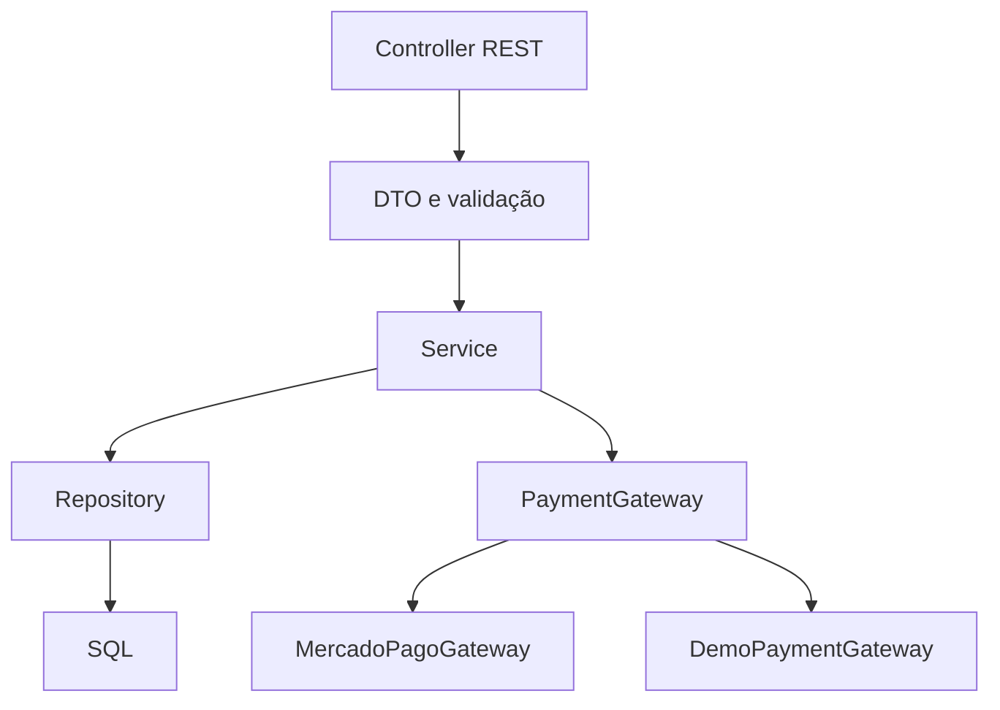

# Comunicação Mesa Pedido — Mesa & Forno

Aplicação Java 21 / Spring Boot 3.5.7 para pedir na mesa por QR Code, pagar pelo Mercado Pago e acompanhar o preparo. Interface responsiva em HTML, CSS e JavaScript nativo; API REST; DTOs e Bean Validation; JPA, SQL e Flyway; JUnit 5 e Mockito.

## Executar a demonstração

Requisitos: **JDK 21** (incluindo compilador) e **Maven 3.9+**.

```bash
mvn clean verify
mvn spring-boot:run -Dspring-boot.run.profiles=demo
```

1. Abra http://localhost:8080/caixa.html. Login local: `caixa`, senha **`demo-caixa-local`**.
2. Clique em **Mesas e QR Codes**, cadastre a mesa 1 e abra seu cardápio pelo link ou QR.
3. Escolha pizzas, bebidas, acompanhamentos e sobremesas. Informe observações e continue para o pagamento.
4. Clique em **DEMO: simular pagamento aprovado**. Nenhuma cobrança é feita.
5. No painel do caixa, veja o pedido, o registro do pagamento e avance **Pago → Em preparo → Pronto → Entregue**.

A aplicação não cria mesas com tokens públicos previsíveis. Cada cadastro gera um token aleatório. As placas podem ser impressas pelo painel. Acesse sempre o QR da mesa para fazer um pedido; abrir `/` sem mesa permite consultar o cardápio.

Para testar pelo celular, use `APP_BASE_URL=http://IP-DO-COMPUTADOR:8080`, inicie com o perfil demo e conecte ambos à mesma rede. Reimprima as placas após alterar o endereço. Em produção, use domínio HTTPS.

## Pagamentos reais e PostgreSQL

```bash
cp .env.example .env
# Edite .env com as credenciais e domínio da pizzaria.
docker compose up --build -d
```

O Docker executa os testes no build, sobe PostgreSQL persistente e expõe a aplicação em `127.0.0.1:8080`. Coloque um proxy reverso HTTPS, como Caddy ou Nginx, na frente. Não há publicação automática de domínio/servidor neste repositório. O Compose não usa o perfil demo.

| Variável                           | Finalidade                                                          |
| ---------------------------------- | ------------------------------------------------------------------- |
| `CASHIER_USER`                     | Usuário do caixa; padrão `caixa`                                    |
| `CASHIER_PASSWORD`                 | Obrigatória fora do perfil demo; mínimo 12 caracteres               |
| `APP_BASE_URL`                     | URL externa HTTPS usada nas placas e no retorno do checkout         |
| `MP_ACCESS_TOKEN`                  | Access token da conta Mercado Pago da pizzaria; somente no servidor |
| `PAYMENT_MODE`                     | `mercadopago` por padrão; `demo` somente para simulação             |
| `DB_URL`, `DB_USER`, `DB_PASSWORD` | Conexão SQL; fora do Compose há H2 em arquivo como padrão local     |

O Spring Boot não carrega `.env` automaticamente ao executar `mvn`; esse arquivo é lido pelo Docker Compose. Ao rodar Java diretamente, forneça as variáveis pelo ambiente.

### Como a confirmação funciona

O servidor cria uma preferência de checkout com valor calculado a partir do banco, moeda BRL e referência única do pedido. Pix e cartão são escolhidos no ambiente do Mercado Pago conforme a disponibilidade da conta. Dados de cartão e CVV nunca passam pela aplicação.

O retorno do navegador não confirma pagamento. A confirmação vem da API autenticada do Mercado Pago: status `approved`, referência do pedido, moeda e valor exatos. Uma conciliação a cada 30 segundos verifica pedidos pendentes que já abriram checkout, mesmo com o navegador fechado. Falhas do provedor mantêm o pedido pendente e geram nova tentativa no ciclo seguinte. O botão “Já paguei” consulta imediatamente. O caixa atualiza a cada 5 segundos.

O painel exibe o identificador da transação, o valor, a data e a hora confirmados pelo sistema. O link **Ver comprovante** abre um registro interno imprimível. Esse registro não é um comprovante bancário emitido pelo provedor nem nota fiscal; o comprovante oficial fica no Mercado Pago. Não é necessário enviar foto de comprovante e fotos não são usadas como prova de pagamento.

Antes de operar, configure uma aplicação e credenciais no Mercado Pago e homologue **Pix e cartão** com as contas de teste do provedor. Esta integração não foi testada com credenciais reais nesta entrega. Nunca habilite `demo` no atendimento real. A simulação retorna 404 quando o modo é Mercado Pago.

## Camadas



- `controller`: recursos REST e contratos HTTP; não serializa entidades.
- `dto`: entradas validadas e saídas explícitas, sem expor credenciais ao caixa.
- `service`: regras de pedido, autorização por token, cálculo, QR e transições.
- `repository`: persistência JPA e bloqueio transacional.
- `domain`: produtos, mesas, pedidos e itens com preço/nome preservados no momento da compra.
- `payment`: integração externa e simulador isolado por configuração.
- `config`: autenticação do caixa, CSRF, CSP e hash da senha.
- `exception`: erros HTTP de validação, negócio, concorrência e indisponibilidade.

O schema está em `src/main/resources/db/migration/V1__schema.sql`. Flyway aplica migrações e o Hibernate apenas valida o schema. Não use `ddl-auto=update`. O cardápio inicial é ilustrativo: substitua nomes, descrições, preços e disponibilidade por migrações SQL antes de abrir ao público.

## API REST

Consulte [docs/API.md](docs/API.md) para exemplos, autenticação e erros.

## Testes

```bash
mvn verify
# Com PostgreSQL local, banco mesapedido e usuário/senha test:
mvn -Dtest=PostgresIntegrationTest -Dpostgres.url=jdbc:postgresql://localhost:5432/mesapedido test
```

JUnit 5 e Mockito cobrem cálculo, snapshot de preços, indisponibilidade, tokens, duplicidade, divergência de valor/moeda/referência, reuso do checkout, confirmação idempotente, conciliação e transições. MockMvc exercita o fluxo completo com persistência H2 real, migrações, autenticação, CSRF, validações e QR PNG. O teste PostgreSQL é condicional e executado em um job próprio do GitHub Actions. Os testes do provedor usam respostas HTTP simuladas e não fazem cobranças.

## Limites operacionais

Este é um MVP para uma pizzaria, sem cadastro de clientes. O token do pedido é salvo no navegador e autoriza sua consulta; use dispositivos pessoais. O QR identifica a mesa, mas não prova presença física: alguém com uma foto pode abrir o cardápio e pagar um pedido para aquela mesa.

Há bloqueio pessimista e unicidade de chave de requisição/transação no banco para evitar confirmação duplicada. Pedidos repetidos com a mesma chave recebem conflito; a interface bloqueia cliques durante o envio. Pedidos pendentes não entram na fila. A fila mostra os 100 pedidos pagos mais recentes, incluindo entregues quando solicitado.

A conciliação é sequencial, adequada a baixo volume. Antes de ampliar, adicione paginação, limites de requisição, expiração de pendências e processamento assíncrono com webhook assinado e consulta de confirmação. Estornos, chargebacks, cancelamentos, recuperação de um pedido após perda do navegador, edição de cardápio pelo painel, impressão automática em impressora térmica e emissão fiscal não estão implementados. Um segundo pagamento indevido deve ser tratado na conta do provedor. Monitore a operação e os pagamentos nessa conta.

Mantenha backup do PostgreSQL e proteção HTTPS; restrinja o caixa à equipe. A senha fixa do perfil demo serve somente para desenvolvimento.

Referências oficiais: [Spring Boot](https://docs.spring.io/spring-boot/3.5/) e [Mercado Pago Checkout Pro](https://www.mercadopago.com.br/developers/pt/docs/checkout-pro/overview).
